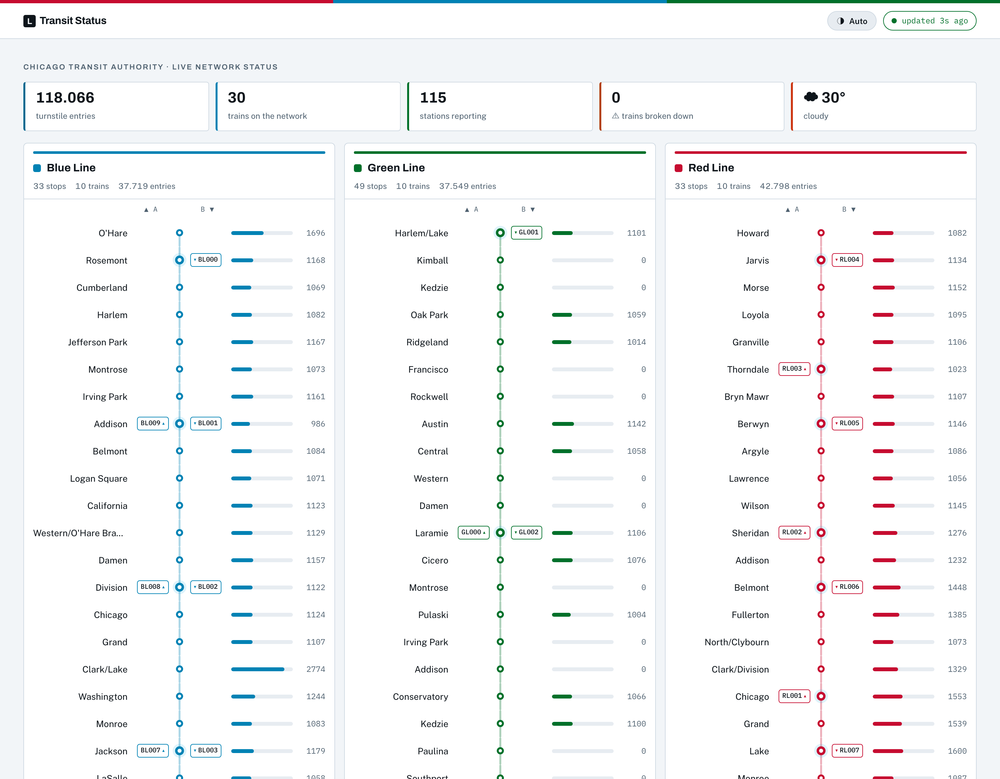

# Public Transit Status with Apache Kafka

A streaming event pipeline built around Apache Kafka and its ecosystem. Using public data from the
[Chicago Transit Authority](https://www.transitchicago.com/data/), it simulates the "L" train network
and displays the status of every line in real time.



> **New here?** Open [`docs/index.html`](docs/index.html) in a browser for an illustrated walkthrough
> of how the pipeline works, stage by stage. No Kafka knowledge assumed.

## Architecture

```
                 ┌──────────────┐     JDBC      ┌─────────────┐
  PostgreSQL ───▶│ Kafka Connect│──────────────▶│             │
                 └──────────────┘               │             │
                                                │             │     ┌───────┐
  Arrivals    ──────── Avro ────────────────────▶    Kafka    │────▶│ Faust │──┐
  Turnstiles  ──────── Avro ────────────────────▶             │     └───────┘  │
                                                │             │                │
                 ┌──────────────┐               │             │     ┌───────┐  │
  Weather    ───▶│  REST Proxy  │──────────────▶│             │────▶│ ksqlDB│──┤
                 └──────────────┘               └─────────────┘     └───────┘  │
                                                       │                       │
                                                       └───────────┬───────────┘
                                                                   ▼
                                                        Transit Status Server
                                                        http://localhost:8888
```

Six stages, each feeding the next:

| Stage | What it does | Output topic |
|---|---|---|
| Station producers | Emit an Avro `arrival` event every time a train reaches a station | `chicago.transport.arrivals` |
| Turnstile producers | Emit one Avro event per rider entering a station | `chicago.transport.turnstile` |
| Weather producer | Posts Avro through **REST Proxy** (the hardware cannot run a Kafka client) | `chicago.transport.weather` |
| Kafka Connect | JDBC source connector, pulls the `stations` table out of PostgreSQL | `chicago.transport.stations` |
| Faust | Trims the raw station rows and resolves the line colour | `chicago.transport.stations.table` |
| ksqlDB | Aggregates turnstile events into a running count per station | `TURNSTILE_SUMMARY` |

The Tornado web server consumes the last four topics and renders the dashboard.

## Prerequisites

* **Docker** with at least 8 GB allocated to the engine (the stack runs five JVMs)
* **Python 3.13**
* `linux/amd64` or `linux/arm64` — every image is multi-arch, including Apple Silicon

## Running the stack

```bash
docker compose up -d --build
```

The first run builds the Kafka Connect image (it installs the JDBC connector) and pulls roughly 3 GB
of images. Every service declares a healthcheck, so instead of guessing how long to wait:

```bash
docker compose ps          # wait until all services report (healthy)
```

Once they are healthy, these endpoints are available:

| Service | URL | Notes |
|---|---|---|
| Transit Status dashboard | http://localhost:8888 | started separately, see below |
| Kafka UI | http://localhost:8085 | topics, schemas, connectors and ksqlDB in one place |
| Kafka | `PLAINTEXT://localhost:9092` | inside the compose network: `kafka:19092` |
| Schema Registry | http://localhost:8081 | |
| REST Proxy | http://localhost:8082 | |
| Kafka Connect | http://localhost:8083 | inside the compose network: `connect:8083` |
| ksqlDB | http://localhost:8088 | |
| PostgreSQL | `jdbc:postgresql://localhost:5432/cta` | user `cta_admin`, password `chicago` |

Services that run **inside** Docker must address each other by service name, never `localhost`. That
is why the JDBC connector connects to `postgres:5432` while the Python clients, which run on your
machine, use `localhost`.

To override any credential or the KRaft cluster id, copy `.env.example` to `.env`. The stack starts
fine without it.

## Running the simulation

Four processes, each in its own terminal. The producer and the consumer must run **at the same
time** for the dashboard to show anything.

### 1. Producers

```bash
cd producers
python3.13 -m venv venv
. venv/bin/activate
pip install -r requirements.txt
python simulation.py
```

This registers the Kafka Connect JDBC connector and then starts emitting arrival, turnstile and
weather events. `Ctrl+C` to stop.

### 2. Faust stream processor

```bash
cd consumers
python3.13 -m venv venv
. venv/bin/activate
pip install -r requirements.txt
faust -A faust_stream worker -l info
```

### 3. ksqlDB table

```bash
cd consumers && . venv/bin/activate
python ksql.py
```

Runs once and exits. It is idempotent: if `TURNSTILE_SUMMARY` already exists, it does nothing.

### 4. Transit status server

```bash
cd consumers && . venv/bin/activate
python server.py
```

Then open http://localhost:8888. The page refreshes every ten seconds.

The server refuses to start until `TURNSTILE_SUMMARY` and the Faust stations table exist, so run
steps 2 and 3 first.

## Project layout

```
├── docker-compose.yaml          Kafka (KRaft), Schema Registry, REST Proxy,
│                                Connect, ksqlDB, Kafka UI and PostgreSQL
├── docker/connect/Dockerfile    Connect plus the JDBC connector
├── load_stations.sql            Seeds the `stations` table from the CTA CSV
├── docs/index.html              Illustrated walkthrough of the pipeline
├── consumers
│   ├── server.py                Tornado web server (port 8888)
│   ├── consumer.py              Kafka consumer wrapper used by the server
│   ├── faust_stream.py          Stations stream processor
│   ├── ksql.py                  Creates the turnstile summary table
│   ├── topics.py                Canonical topic names, shared by all consumers
│   ├── topic_check.py           Startup preflight checks
│   ├── models/                  Line, Station and Weather view models
│   └── templates/status.html
└── producers
    ├── simulation.py            Entry point for the whole producer side
    ├── connector.py             Registers the JDBC source connector
    ├── data/                    CTA station and ridership CSVs
    └── models/
        ├── producer.py          Avro producer base class
        ├── station.py           Arrival events
        ├── turnstile.py         Turnstile events
        ├── weather.py           Weather events, through REST Proxy
        ├── line.py, train.py    Simulation logic (no Kafka)
        └── schemas/             Avro key and value schemas
```

## Troubleshooting

**`docker compose up` fails on the kafka service after changing `CLUSTER_ID`.** The id is written
into the metadata log on first boot. Run `docker compose down -v` to discard the volumes.

**The dashboard is empty.** Check, in order: the producers are running, `faust` is running,
`python ksql.py` has been run, and the topics have messages (Kafka UI, http://localhost:8085).

**The connector never produces anything.** Inspect it at
`curl -s localhost:8083/connectors/stations/status`. A `FAILED` task usually means PostgreSQL was not
reachable; the connector must address it as `postgres:5432`.

**Delete a misconfigured connector:** `curl -X DELETE localhost:8083/connectors/stations`

## Documentation

* [Confluent Python Client](https://docs.confluent.io/kafka-clients/python/current/overview.html)
* [REST Proxy API Reference](https://docs.confluent.io/platform/current/kafka-rest/api.html)
* [JDBC Source Connector Configuration](https://docs.confluent.io/kafka-connectors/jdbc/current/source-connector/source_config_options.html)
* [ksqlDB SQL Reference](https://docs.confluent.io/platform/current/ksqldb/reference/sql/index.html)
